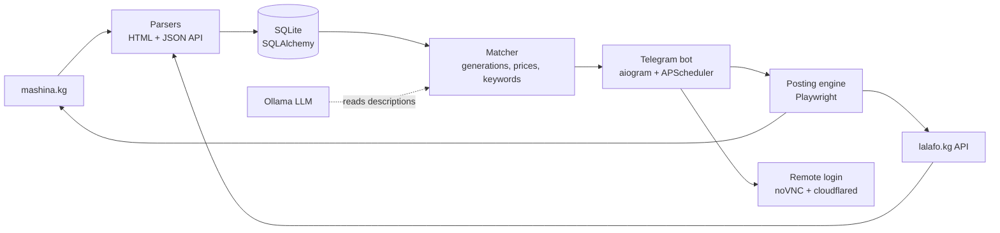

# Car Deal Monitor

**Telegram bot for car resellers. It scans car marketplaces for underpriced listings, uses an LLM to read their descriptions, and posts and bumps your own ads through browser automation.**


> I built it for myself and a few acquaintances who buy and resell cars in Kyrgyzstan through **mashina.kg** and **lalafo.kg**, the two largest car classifieds sites in the country.

---

## The problem

A reseller's margin depends on seeing a good car first. Doing it by hand means refreshing two sites all day, reading every description for "salvage" or "installment price" traps, and spending time re-posting and bumping your own listings.

## What it does

**Finding deals**
- Saved searches by **model generation + price range**, checked on a schedule. Matches arrive in Telegram with the top-3 cheapest comparable cars and the average market price.
- `/add_sold`: log a car you sold and the bot creates a "find me another one like this" search at the sale price ± tolerance.
- `/pricecheck`: instant market check for any model, with the cheapest active offers and the average price.
- **Full market scans** of both sites, a searchable archive of every listing, and keyword tracking.

**AI reading descriptions (local LLM via Ollama)**
- Excludes cars that are damaged, "for parts", not running, unregistered or located abroad, plus fake prices (down payment, installment or rent) from averages and alerts.
- Looks for custom tags in descriptions ("Korean import", "Limited trim"). **If the description doesn't say, the bot messages the seller in lalafo chat** from the owner's account (with rate limits) and parses the reply with AI.

**Managing your own ads**
- Posts and **bumps listings** on mashina.kg and lalafo.kg with Playwright, plus "adopt" of existing ads across platforms.
- **Remote login from Telegram**: the bot opens a browser on a virtual display in the container and streams it to your phone through **noVNC + a temporary Cloudflare tunnel** with a one-time password. You can send the SMS code as a chat message and the bot types it in.

## Architecture



## Tech stack

`Python` · `aiogram 3` · `APScheduler` · `SQLAlchemy 2` · `httpx` · `BeautifulSoup4` · `Playwright` (Chromium) · `Ollama` · `noVNC` · `cloudflared` · `Docker` · macOS `launchd`

## Engineering highlights

- A vehicle identification layer maps free-text titles to make, model and **generation** so price comparisons are fair.
- Currency normalization (USD/KGS) and outlier-safe market averages.
- Persistent browser profiles with lock handling, so sessions don't get logged out by parallel runs.
- Seller messaging has strict limits (≤10 per search, ≤30 per day, one per listing) to stay polite and avoid bans.
- Docker image with Chromium and a virtual display. GitHub auto-pull with an owner-only "🔄 Update" button in the bot.

## Quick start

```bash
cp .env.example .env     # BOT_TOKEN, OWNER_TELEGRAM_ID
pip install -r requirements.txt
playwright install chromium
python main.py
```

Or `docker compose up -d`.

---

📄 Detailed user documentation (Russian): [README.ru.md](README.ru.md) · Parsing notes: [docs/](docs/)

💼 Need a marketplace monitor or browser automation bot? **[Hire me on Upwork](https://www.upwork.com/freelancers/~01b79ffa28442df3f8)**
